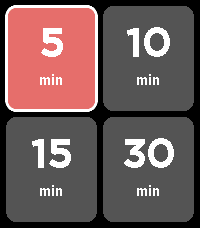
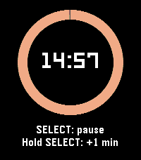
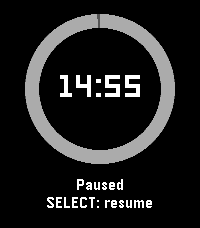
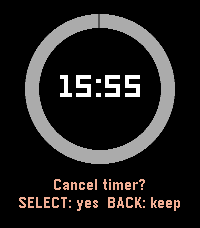

# Quick Timers

A Pebble watchapp for the **Pebble Time 2** (platform `emery`, 200×228, color, touch).
Pick 5, 10, 15 or 30 minutes from a 2×2 grid. The timer keeps running after you
leave the app, and the watch relaunches it when time is up.

| Grid | Running | Paused | Cancel prompt | Done |
|------|---------|--------|---------------|------|
|  |  |  |  |  |

## Controls

| Screen | Button | Action |
|--------|--------|--------|
| Grid | UP / DOWN | Move the highlight (wraps around) |
| Grid | SELECT or tap a square | Start that timer |
| Timer | SELECT | Pause / resume |
| Timer | Hold SELECT | Add 1 minute |
| Timer | BACK | Show "Cancel timer?" prompt |
| Cancel prompt | SELECT | Yes: cancel the timer, back to grid |
| Cancel prompt | BACK | No: keep the timer running and leave the app |
| Done! | Any button | Dismiss the alarm |

When a timer finishes, the watch vibrates a short-short-long pattern every 10 seconds,
for at most 1 minute, until you dismiss it.

## Build and install

The Pebble SDK only runs on Linux/macOS. On Windows, use WSL (Ubuntu 24.04 or newer).

One-time setup inside WSL:

```sh
sudo apt install nodejs npm build-essential libsdl2-2.0-0 libglib2.0-0 libpixman-1-0 zlib1g libsndio7.0
curl -LsSf https://astral.sh/uv/install.sh | sh     # installs uv
uv tool install pebble-tool --python 3.13
pebble sdk install latest
```

Then, from the project folder (e.g. `cd /mnt/e/Git/PT2_QuickTimers`):

```sh
pebble build                          # -> build/PT2_QuickTimers.pbw
pebble install --emulator emery       # run in the emulator
pebble install --phone <PHONE_IP>     # or install on your watch via the phone app
pebble logs --emulator emery          # see APP_LOG output
pebble screenshot                     # screenshot of the emulator
pebble emu-button click select        # press a button from the command line
```

## How the code is organized

```
src/c/
  main.c          entry point: decides which screen to show at launch
  grid_window.c/h the 2x2 grid menu (drawing, buttons, touch)
  timer_window.c/h countdown screen + ALL timer logic + the alarm
  storage.c/h     save/load the active timer in persistent storage
```

The key idea: **a running timer is stored as its end timestamp**, not as a counter.
Remaining time is always `end_time - now`, so it stays correct while the app is
closed. The Wakeup API asks the watch to relaunch the app at `end_time`.

### Function map

**main.c**
| Function | What it does |
|----------|--------------|
| `main()` | `init()` → `app_event_loop()` → `deinit()` (every Pebble app looks like this) |
| `init()` | Pushes the grid, then shows "Done!" (wakeup launch) or resumes a saved timer |
| `launched_by_timer_wakeup()` | Was this launch caused by our wakeup? |
| `handle_wakeup()` | Wakeup fired while the app was already open → show "Done!" |
| `deinit()` | Pops all windows so their unload handlers free memory |

**grid_window.c**
| Function | What it does |
|----------|--------------|
| `grid_window_push()` | Creates the window and shows it (public) |
| `cell_rect()` | Rectangle of square *i*, shared by drawing and touch |
| `cell_at_point()` | Which square contains a point (touch hit-testing) |
| `draw_grid()` | Layer update procedure: paints all four squares |
| `draw_cell()` | Paints one square, highlighted or not |
| `set_selected()` | Moves the highlight and requests a redraw |
| `start_selected_timer()` | Hands the chosen duration to the timer window |
| `up/down/select_click_handler()` | Button callbacks |
| `click_config_provider()` | Connects buttons to handlers |
| `handle_touch()` | Touchdown highlights, liftoff on the same square starts it |
| `window_load/appear/disappear/unload()` | Create layers / (un)subscribe touch / free everything |

**timer_window.c**
| Function | What it does |
|----------|--------------|
| `timer_window_start()` | Starts a new countdown (public) |
| `timer_window_resume_saved()` | Restores a timer saved before the app closed (public) |
| `timer_window_show_done()` | Shows the alarm; used for wakeups (public) |
| `get_remaining_seconds()` | `end_time - now`, or the frozen value when paused |
| `format_time()` | Seconds → `"MM:SS"` |
| `schedule_wakeup()` / `cancel_wakeup()` | Ask the OS to relaunch us at `end_time` / cancel that |
| `pause_timer()` / `resume_timer()` | Freeze / unfreeze (and cancel / reschedule the wakeup) |
| `add_time()` | +1 minute, running or paused |
| `stop_timer()` | Cancel the wakeup and delete the saved timer |
| `draw_progress_ring()` | Layer update procedure: gray track + shrinking colored arc |
| `update_display()` | Syncs all layers with the current mode and time |
| `handle_timer_done()` | Switch to "Done!" mode and start the alarm |
| `play_done_vibe()` / `vibe_timer_callback()` / `stop_done_vibe()` | The repeating alarm |
| `handle_second_tick()` | Called every second: update or detect the end |
| `select/select_long/back/up_down_click_handler()` | Button callbacks (behavior depends on mode) |
| `create_text_layer()` | Helper that makes a centered white TextLayer |
| `show_window()` | Creates/pushes the window or refreshes it if already shown |
| `window_load/unload()` | Create layers + start ticks / stop callbacks + free everything |

**storage.c**
| Function | What it does |
|----------|--------------|
| `storage_save_timer()` | Writes the `TimerState` struct + a version number |
| `storage_load_timer()` | Reads it back; rejects missing or outdated data |
| `storage_clear_timer()` | Deletes it |

### Memory: who frees what

Every `*_create()` has a matching `*_destroy()`, marked `ALLOC` / `FREE` in the comments:

- Layers are created in each window's `window_load()` and destroyed in `window_unload()`.
- Each window is created in `grid_window_push()` / `show_window()` and destroys
  itself in its own `window_unload()`.
- `main.c`'s `deinit()` pops all windows so those unload handlers always run.
- The repeat-vibration `AppTimer` is freed by Pebble when it fires, or by
  `app_timer_cancel()` in `stop_done_vibe()`.

## Exercises

1. **Custom durations.** Replace one square with a "custom" option: open a window
   where UP/DOWN change the minutes and SELECT starts it. Hint: `TIMER_MINUTES`
   in [grid_window.c](src/c/grid_window.c) and `timer_window_start()` already take
   any number of minutes. Bonus: remember the last custom value with `persist_write_int()`.
2. **Named timers.** Give each square a label ("Tea", "Pasta", "Laundry", "Nap") and
   show the name on the timer and "Done!" screens. You'll need to pass the name to
   `timer_window_start()` and store it in `TimerState`. Remember to bump
   `STORAGE_VERSION` in [storage.c](src/c/storage.c) when you change the struct, and
   that a `char name[16]` inside a struct is copied, but a `char *` would not be.
3. **History of finished timers.** Save the last 5 finished timers (duration + finish
   time) in persistent storage, and add a window with a `MenuLayer` that lists them
   (open it with a long press on the grid). Hint: an array of structs and a "next
   index" that wraps around (a *ring buffer*), written in `handle_timer_done()`.
